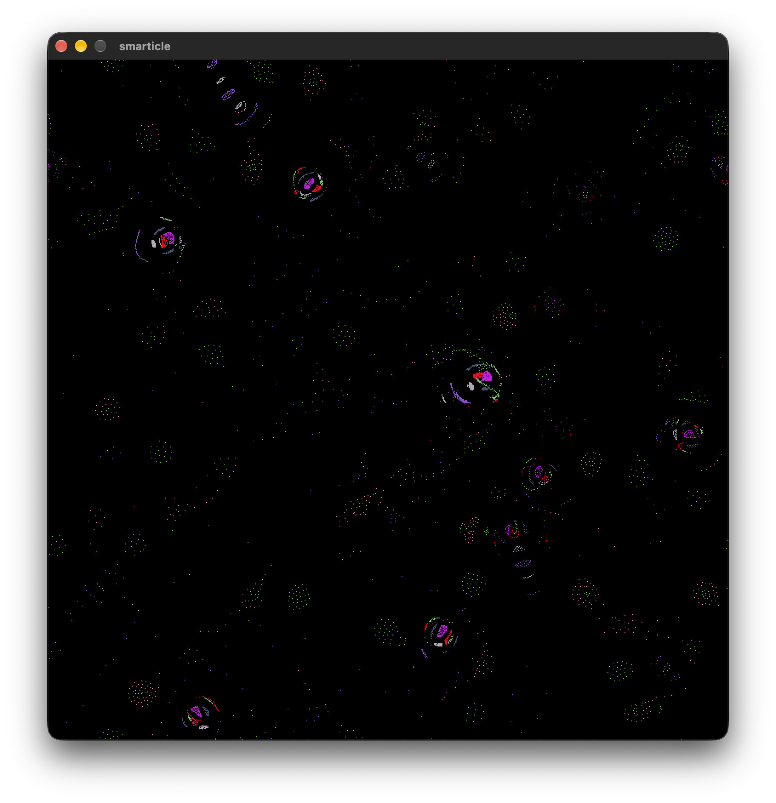

# smarticle

inspired by Tom Mohr: <https://www.youtube.com/watch?v=p4YirERTVF0>



ideas

1. CAN WE GET TO 100,000 particles at 60FPS? (update: probably not)
1. ~start with the most naive solution (every particle looks at every other particle)~
1. ~add some sort of spatial partitioning~
1. maybe add batching for draw calls (can i use the `rlgl` stuff??)
1. SIMD!? does that even help here...(find out)
1. ~make the field infinite (wraps around at the edges)~
1. ~multithreading???~
1. add some sort of UI to tweak the settings
1. make it look pretty

## build / run

```
# generate the build files
cmake -B build .
# and then
cmake --build build
# and then
./build/smarticle
```

